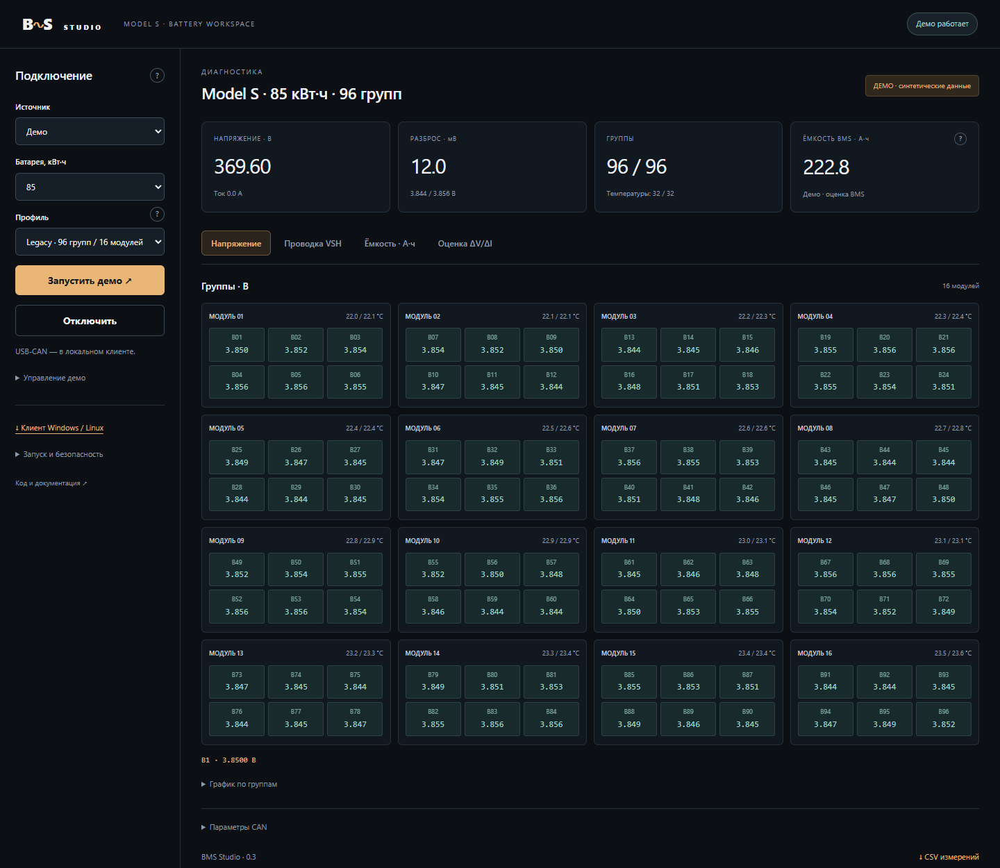

# Tesla BMS Studio

Локальный клиент Windows/Linux и онлайн-демо диагностики Tesla Model S. Целевая линейка: **60, 70, 75, 85, 90 и 100 кВт·ч**. Чтение напряжений групп через PCAN-USB, температура, ток и экспорт расчётного сопротивления. Независимый MIT-форк [jetpax/PiCanScanMyTesla](https://github.com/jetpax/PiCanScanMyTesla), владелец — [DaniilKi](https://github.com/DaniilKi).

**Версия 0.3.** Компактный ежедневный экран, подсказки «?», отдельные разделы VSH и ёмкости в А·ч. Есть профили 83/84/96 групп и режим просмотра неизвестного блока. Ёмкость и профиль выбираются отдельно. Реальное подключение каждой ревизии требует проверки: выбор «100» не доказывает совместимость любого блока 100 кВт·ч, а протоколы 2021+ не реализованы.

**[Открыть публичное онлайн-демо](https://tesla-bms-studio-daniil.daniilk.chatgpt.site/)** — синтетические данные, без входа в аккаунт. Для оценки R: сохранить A → переключить демо-ток 0/50 А → дождаться обновления → сохранить B → «Оценка R» → CSV.



## Start the new app

### Простой запуск

Скачайте [ZIP исходного кода](https://github.com/DaniilKi/tesla-bms-studio/archive/refs/heads/main.zip) и распакуйте:

- **Windows:** двойной щелчок `start-windows.cmd`.
- **Linux:** `bash start-linux.sh` из папки приложения.

Нужен Python 3.10+. Первый запуск создаёт `.venv` и устанавливает Python-зависимости, затем открывает браузер. Драйверы и CAN-настройки он не меняет. Для Windows PCAN нужны официальный драйвер PEAK и PCAN-Basic. В Linux используется заранее настроенный SocketCAN. Python-зависимости фиксированы в `requirements.txt`.

Requires Python 3.10 or newer. No administrator account or battery is needed for the demo.

Windows PowerShell:

```powershell
git clone https://github.com/DaniilKi/tesla-bms-studio.git
cd tesla-bms-studio
python -m venv .venv
.\.venv\Scripts\python.exe -m pip install -r requirements.txt
.\.venv\Scripts\python.exe -m studio.app
```

Linux:

```bash
git clone https://github.com/DaniilKi/tesla-bms-studio.git
cd tesla-bms-studio
python3 -m venv .venv
.venv/bin/python -m pip install -r requirements.txt
.venv/bin/python -m studio.app
```

Откройте **http://127.0.0.1:8080** и нажмите **Запустить демо**. Остановка: Ctrl+C. Для другого порта: `python -m studio.app --port 8081` из подготовленного окружения.

## What works

- Demo with synthetic CAN-format data; no CAN device is opened.
- Connection form for Linux SocketCAN (`can0`) and Windows PCAN-Basic (`PCAN_USBBUS1`).
- Независимые настройки ёмкости 60–100 кВт·ч и профиля 83/84/96 групп; карта без жёсткой привязки к 96.
- Напряжение, ток, температуры, минимум/максимум, разброс и полнота данных. Температурная карта унаследована и предварительна.
- Missing/stale readings, with individual signals expiring after 45 seconds.
- Два измерения A/B и **оценка кажущегося сопротивления группы** `−ΔV/ΔI` с проверкой знака, тока и времён.
- CSV исходных измерений и CSV оценки R: обе пары V/I, отметки времени, условия и причины пропусков. Импорт этой пары обрабатывается только в браузере.
- Локальный CAN-сервис доступен только на localhost. Онлайн-демо использует синтетические данные и не имеет доступа к USB-CAN.
- Ёмкость BMS **CAC min**, А·ч: legacy `0x7E2/mux0`, минимум оценки ёмкости группы. Без свежего сигнала — прочерк. Это не SOH и не измерение каждой физической ячейки.
- Отдельные счётчики записанного положительного/отрицательного тока в А·ч. Пропуски исключаются; знак заряда/разряда выбирается после проверки. Короткая запись не является тестом полной ёмкости.
- Карта **VSH R0–R6** по BMB, в мОм; демо и импорт/экспорт расшифрованного CSV. Live-протокол этих полей ещё не подтверждён. VSH не подменяет сопротивление группы или А·ч.

Разбор измерений, размещение в интерфейсе и источники: [Capacity and VSH](docs/CAPACITY_AND_VSH.md).

**Прямой сигнал внутреннего сопротивления группы из BMS пока не подтверждён.** Приложение не вычисляет R из одного вольтажа и не выдаёт сопротивление изоляции или проводов VSH за сопротивление ячеек. У группы параллельно соединённых ячеек измеряется общий отклик; это не R каждой физической ячейки. Расчёт — экспериментальная оценка, а не стандартизованный DCIR-тест. Подробности и источники: [60–100 кВт·ч и сопротивление](docs/MULTIPACK_AND_RESISTANCE.md).

The app starts disconnected. It never sends application CAN frames. PCAN opens with `BusState.PASSIVE`. SocketCAN uses the existing Linux controller configuration; opening a socket does **not** enforce hardware listen-only or set bitrate. The operator must verify those settings outside the app. A sleeping bench BMS may remain silent; silence alone is not a failed battery or adapter.

Профили относятся к семейству legacy S/X 2012–2020: classic 11-bit CAN, 500 kbit/s. Ревизии блока, формат 0x6F2 и число каналов проверяются отдельно. Аппаратной проверки PCAN/батареи в этой разработке не было.

## Project documents

- [Project definition, terminology and acceptance](docs/PROJECT.md)
- [Conversation analysis and source verification](docs/CONVERSATION_ANALYSIS.md)
- [Implementation plan and current status](docs/ROADMAP.md)
- [Contribution and access plan](CONTRIBUTING.md)
- [Original upstream README](docs/UPSTREAM_README.md)

## Legacy files

Root `teslamon.py`, `index.html`, `install.sh`, `systemd/` and `NOTES.md` are retained upstream code/reference material. They are **not the new app's entry point**. The original program includes automatic wake transmissions, diagnostic security access, fault clearing and vehicle emulation capable of commanding contactor closure. Do not use its installer to launch this receive-only app. Upstream repair and wiring observations are not validated instructions for your specific pack.

## Verify

```powershell
.\.venv\Scripts\python.exe -m unittest discover -s tests -v
```

On Linux, use `.venv/bin/python` instead. Tests cover decoding, invalid/stale signals, input boundaries, demo isolation, PCAN passive initialization, disconnect and simulated CAN reception. Hardware testing is separate.

Расчёты и CSV также проверяются командой `node --test tests/analysis.test.mjs tests/diagnostics.test.mjs` (Node 22+). GitHub Actions запускает обе проверки на Windows и Linux; аппаратное подключение в CI не проверяется.

## License

[MIT](LICENSE), including the original copyright. Independent fork, not an official Tesla product. Owning this fork does not transfer exclusive ownership of the original author's code.
